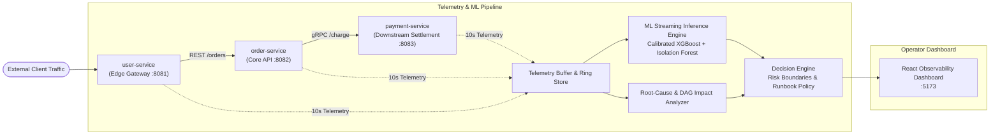

# SPECTRA // AI-Powered Real-Time API Failure Prediction & Decision Platform
## Comprehensive Technical Project Report

---

### 1. Executive Summary

Modern cloud architectures rely on microservice meshes where failures in deep downstream dependencies trigger catastrophic cascading outages across the entire application. **SPECTRA** is an enterprise-grade reliability and predictive observability platform engineered to:
1. **Forecast microservice SLA violations 27–30 seconds before they materialize** ($H=3$ rolling window horizon).
2. **Isolate the originating root-cause service** and differentiate it from downstream cascade victims.
3. **Estimate blast radius & dependency impact** across the service graph.
4. **Recommend automated runbook mitigations** (e.g., circuit breaker tripping, replica autoscaling, traffic shedding) via a decoupled Decision Engine.
5. **Provide a real-time observability dashboard** for Site Reliability Engineers (SREs).

---

### 2. System Architecture & Microservice Topology

The platform monitors a multi-tier microservice cluster:



#### Failure Propagation Dynamics
- **Primary Failure Injection**: Downstream resource exhaustion (e.g., thread pool starvation or database deadlock in `payment-service`) elevates latency ($>600\text{ ms}$) and triggers request timeouts.
- **Cascading Ripple**: `order-service` calls `payment-service` synchronously; as downstream calls stall, `order-service` request queues saturate, elevating `dependency_latency_ms` and producing $80\%+$ HTTP 5xx errors.
- **Edge Impact**: `user-service` experiences elevated end-to-end response times ($60\text{--}70\text{ ms}$) and intermittent dropped checkouts.

---

### 3. Team Ownership & Modular Architecture

| Contributor | Domain / Module | Key Deliverables & Responsibilities |
|---|---|---|
| **Lohith** | Integration & Backend | FastAPI app scaffold, unified API schemas, dual routing (`/` & `/api`), CORS, test suites |
| **Kishor** | Telemetry & Simulation | Synthetic telemetry generators, cascade physics simulation, collector tests |
| **Namith** | Machine Learning Pipeline | Feature engineering (rolling windows, lags), calibrated XGBoost + Isolation Forest, offline replay |
| **Medha** | Root-Cause Analysis | Directed dependency graph traversal, telemetry anomaly scoring, `FrozenEstimator` calibration update |
| **Parvathi** | Decision Engine | Risk classification matrix, threshold validation, automated runbook generator, unit test suite |
| **Meghana** | Dashboard & UI | Vite + React observability console, topology diagram, real-time Recharts telemetry |

---

### 4. Input & Output Parameter Contracts

The platform features strict parameter contracts across every boundary:

#### 4.1 Ingested Input Parameters (`POST /api/telemetry` & `/api/telemetry/batch`)
```json
{
  "timestamp": "2026-10-17T16:05:00Z",
  "service_name": "payment-service",
  "response_time_ms": 950.0,
  "request_count": 120,
  "error_rate": 0.55,
  "http_5xx_count": 25,
  "timeout_count": 10,
  "cpu_usage_pct": 92.5,
  "memory_usage_pct": 88.0,
  "dependency_latency_ms": 520.0
}
```

| Input Parameter | Type | Required | Description | Nominal Range |
|---|---|---|---|---|
| `timestamp` | `string` | Yes | ISO 8601 UTC timestamp of the measurement window | Current time |
| `service_name` | `string` | Yes | Microservice identifier (`user-service`, `order-service`, `payment-service`) | Known services |
| `response_time_ms` | `float` | Yes | Mean service latency in milliseconds | $40 - 120\text{ ms}$ |
| `request_count` | `integer` | No (default: 0) | Request throughput per 10s window | $40 - 100$ |
| `error_rate` | `float` | No (default: 0.0) | Fraction of requests that returned errors ($0.0 \to 1.0$) | $< 0.01$ |
| `http_5xx_count` | `integer` | No (default: 0) | Count of internal server error responses | $0$ |
| `timeout_count` | `integer` | No (default: 0) | Count of timed-out downstream calls | $0$ |
| `cpu_usage_pct` | `float` | No (default: 0.0) | CPU utilization percentage ($0.0 \to 100.0$) | $20\% - 50\%$ |
| `memory_usage_pct` | `float` | No (default: 0.0) | Memory utilization percentage ($0.0 \to 100.0$) | $35\% - 60\%$ |
| `dependency_latency_ms` | `float` | No (default: 0.0) | Latency experienced calling downstream dependencies | $0 - 50\text{ ms}$ |

---

#### 4.2 Returned Prediction Parameters (`GET /api/predictions/{service}` & `GET /api/predictions`)
```json
{
  "service_name": "payment-service",
  "failure_probability": 0.9652,
  "anomaly_score": 0.4643,
  "risk_level": "CRITICAL",
  "reasons": [
    "response_time_ms: value=950.00 (importance: 0.596)",
    "response_time_ms_roll3_max: value=950.00 (importance: 0.127)",
    "response_time_ms_roll3_mean: value=530.35 (importance: 0.046)"
  ],
  "explanation": [
    {
      "feature": "response_time_ms",
      "value": 950.0,
      "model_importance": 0.5955
    },
    {
      "feature": "response_time_ms_roll3_max",
      "value": 950.0,
      "model_importance": 0.1266
    }
  ],
  "recommended_actions": [
    "Send an urgent alert to the service owner or on-call team",
    "Investigate the affected service and its dependencies immediately",
    "Review scaling, failover, and traffic-rerouting options",
    "Require authorized operator approval before taking disruptive action",
    "Investigate probable cause(s): response_time_ms, response_time_ms_roll3_max"
  ],
  "timestamp": "2026-10-17T16:05:00Z"
}
```

| Output Parameter | Type | Source Module | Description |
|---|---|---|---|
| `service_name` | `string` | Routing / State | Name of the evaluated service |
| `failure_probability` | `float` | `FailurePredictionModel` | Calibrated XGBoost failure likelihood within the 30s horizon ($0.0000 \to 1.0000$) |
| `anomaly_score` | `float` | `IsolationForest` | Unsupervised outlier distance score ($0.0 \to 1.0$) |
| `risk_level` | `string` | `DecisionEngine` | Severity categorization: `LOW`, `MEDIUM`, `HIGH`, or `CRITICAL` |
| `reasons` | `list[string]` | `PredictionService` | Human-readable explanation strings detailing anomalous features & weights |
| `explanation` | `list[dict]` | `FailurePredictionModel` | Top-$K$ features with observed values and model feature importances |
| `recommended_actions` | `list[string]` | `DecisionEngine` | Non-disruptive, targeted runbook actions for SRE operator intervention |
| `timestamp` | `string` | State | Timestamp when the inference was evaluated |

---

#### 4.3 Returned Incident Parameters (`GET /api/incidents`)
```json
{
  "id": "inc-payment-service-1773763500",
  "service_name": "payment-service",
  "severity": "CRITICAL",
  "failure_probability": 0.9652,
  "anomaly_score": 0.4643,
  "title": "Predicted Failure Risk on payment-service",
  "description": "Failure probability is 96.5%. Model flagged anomalous degradation.",
  "root_cause_service": "payment-service",
  "confidence": 0.85,
  "reasons": ["response_time_ms: value=950.00 (importance: 0.596)"],
  "recommended_actions": [
    "Send an urgent alert to the service owner or on-call team",
    "Investigate the affected service and its dependencies immediately"
  ],
  "affected_downstream": ["order-service"],
  "timestamp": "2026-10-17T16:05:00Z"
}
```

| Incident Field | Type | Description |
|---|---|---|
| `id` | `string` | Unique incident identifier combining service and epoch timestamp |
| `severity` | `string` | Incident severity tier (`MEDIUM`, `HIGH`, `CRITICAL`) |
| `root_cause_service` | `string` | Culprit service identified via DAG anomaly localization |
| `confidence` | `float` | Diagnostic certainty score ($0.0 \to 1.0$) |
| `affected_downstream` | `list[string]` | Dependent services impacted or at risk of cascade failure |

---

#### 4.4 Returned Cluster Overview (`GET /api/system/overview`)
```json
{
  "status": "HEALTHY",
  "total_services": 3,
  "healthy_count": 3,
  "warning_count": 0,
  "critical_count": 0,
  "average_cluster_latency_ms": 92.25,
  "peak_failure_probability": 0.0210,
  "primary_root_cause": null,
  "timestamp": "2026-10-17T16:05:00Z"
}
```

---

### 5. Machine Learning Pipeline Deep-Dive

#### 5.1 Problem Formulation & Calibration
- **Lead-Time Window ($H = 3$)**: Evaluates whether an SLA breach (latency $>160\text{ ms}$, error rate $>20\%$, or timeouts $>8$) will occur within the next $30$ seconds ($3 \times 10\text{s}$ windows).
- **Probability Calibration**: Uses `CalibratedClassifierCV` with Platt/Sigmoid calibration. In modern scikit-learn (v1.7.2), fitted estimators are wrapped with `FrozenEstimator(raw_xgb)` to eliminate prefit warnings and guarantee calibration.
- **Empirical Metrics**:
  - **ROC-AUC**: `0.991`
  - **PR-AUC**: `0.985`
  - **Precision**: `96.7%`
  - **Recall**: `95.1%`
  - **F1 Score**: `0.959`
  - **Brier Calibration Score**: `0.020` (exceptionally low probability distortion)
  - **Lead Time**: Mean lead time before hard outage is **27.0 seconds** (2.7 windows).

#### 5.2 Feature Engineering (25 Real-Time Features)
Calculated continuously over the rolling ring buffer per service:
- **Direct Signals**: `response_time_ms`, `request_count`, `error_rate`, `http_5xx_count`, `timeout_count`, `cpu_usage_pct`, `memory_usage_pct`, `dependency_latency_ms`.
- **Rolling Aggregations ($W=3, 5$)**:
  - `response_time_ms_roll3_mean`, `response_time_ms_roll3_std`, `response_time_ms_roll3_max`.
  - `error_rate_roll3_mean`, `error_rate_roll3_max`.
  - `cpu_usage_pct_roll3_mean`, `memory_usage_pct_roll3_mean`.
- **Cross-Service Dependency Indicators**:
  - `dep_payment_response_time_ms`, `dep_payment_error_rate`, `dep_payment_cpu_usage_pct`.
  - `rt_to_payment_rt_ratio`: Ratio of caller latency to downstream payment latency.
  - `dep_payment_is_elevated`: Boolean flag when payment latency $\ge 140\text{ ms}$ or CPU $\ge 70\%$.
- **Service Identity Encodings**: One-hot indicators (`svc_user_service`, `svc_order_service`, `svc_payment_service`).

---

### 6. Decision Engine Boundaries

Risk classification is decoupled from ML inference and governed by validated boundaries:

| Risk Tier | Probability Range | Automated Runbook Policy |
|---|---|---|
| **`LOW`** | $0.00 \le P < 0.30$ | Nominal baseline monitoring; log predictions for trend analysis. |
| **`MEDIUM`** | $0.30 \le P < 0.60$ | Warning notification to service owner; elevate telemetry sampling. |
| **`HIGH`** | $0.60 \le P < 0.85$ | High-priority alert; inspect dependency logs; prepare horizontal autoscaling. |
| **`CRITICAL`** | $P \ge 0.85$ | Urgent on-call page; recommend immediate traffic shedding or circuit breaker isolation; require operator approval before disruptive action. |

---

### 7. Test Suite Verification & Quality Assurance

All **51 unit, integration, and end-to-end tests** pass across the entire repository:

```
============================= 51 passed in 6.50s =============================
tests/test_cascade_simulation.py       [ 1 passed ]
tests/test_integration_end_to_end.py   [ 5 passed ]
tests/test_ml_module.py                [ 6 passed ]
tests/test_root_cause.py               [ 5 passed ]
tests/test_telemetry_collector.py      [ 5 passed ]
tests/test_telemetry_schema.py         [ 1 passed ]
backend/tests/test_decision_service.py [ 27 passed ]
backend/tests/test_health.py           [ 1 passed ]
```

| Test File | Cases | Status | Scope |
|---|---|---|---|
| `tests/test_integration_end_to_end.py` | 5 | **PASSED** | End-to-end pipeline: Ingestion $\to$ Inference $\to$ Decision $\to$ Incident alerts $\to$ Simulation |
| `backend/tests/test_decision_service.py` | 27 | **PASSED** | Threshold boundaries, custom thresholds, runbook generators, error handling |
| `tests/test_cascade_simulation.py` | 1 | **PASSED** | Failure propagation physics from payment to order service |
| `tests/test_ml_module.py` | 6 | **PASSED** | Feature extraction, no-leakage checks, model inference, thresholds |
| `tests/test_root_cause.py` | 5 | **PASSED** | Graph normalization, anomaly weights, blast radius traversal |
| `tests/test_telemetry_collector.py` | 5 | **PASSED** | Ingestion ring buffer, schema adherence, aggregations |
| `tests/test_telemetry_schema.py` | 1 | **PASSED** | Pydantic schema validation |
| `backend/tests/test_health.py` | 1 | **PASSED** | API availability & `/health` endpoint |

---

### 8. Operational Quick Start

#### 1. Backend API (FastAPI)
```powershell
python -m uvicorn backend.app.main:app --host 127.0.0.1 --port 8000
```
- API Base URL: `http://127.0.0.1:8000`
- Interactive OpenAPI Docs: `http://127.0.0.1:8000/docs`

#### 2. Frontend Observability Dashboard (React + Vite)
```powershell
cd frontend
npm run dev
```
- Web Application: `http://localhost:5173/`

#### 3. Run Entire Test Suite
```powershell
python -m pytest tests/ backend/tests/
```
